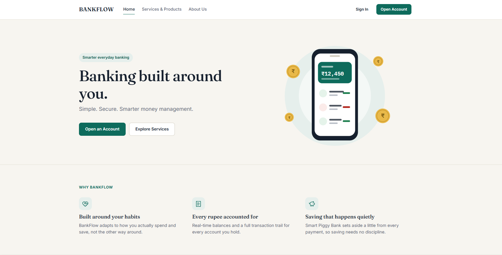
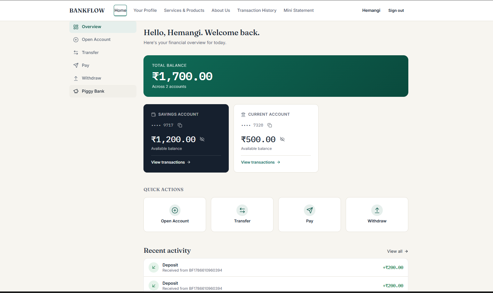
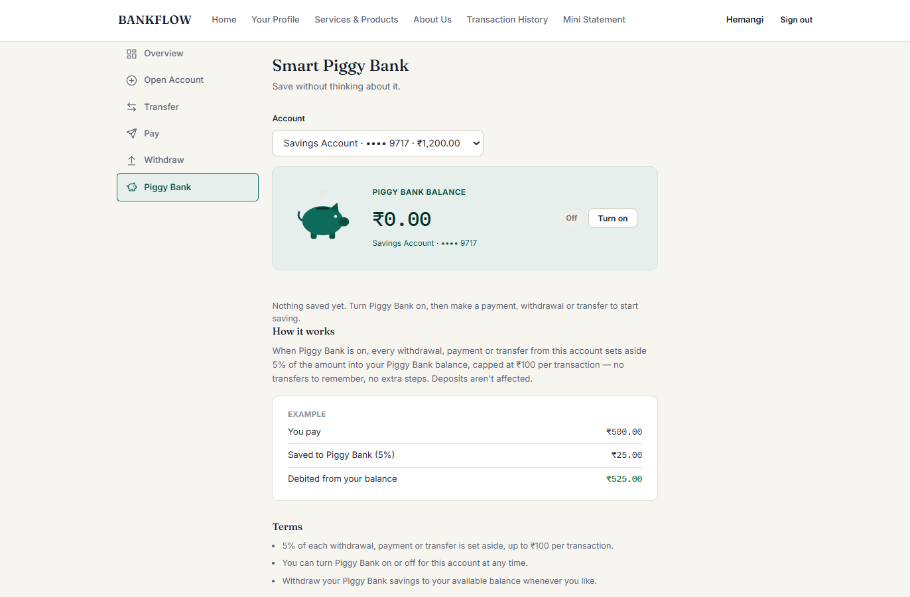
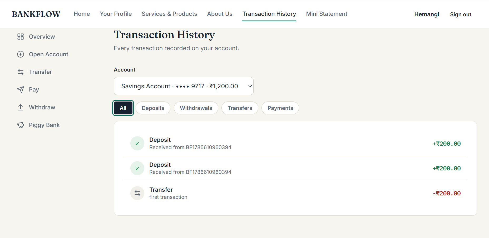

<h1 align="center">BankFlow</h1>

<p align="center">
  A full-stack banking application built with Spring Boot, JWT security, MySQL and React.
</p>

<p align="center">
  
  
  
  
  
</p>

## Overview

BankFlow lets users open savings or current accounts, deposit, withdraw, pay and transfer money, and review their transaction history. An optional Piggy Bank setting automatically sets aside a share of every outgoing transaction as savings.

The backend is a layered Spring Boot REST API secured with stateless JWT authentication. The frontend is a React single-page app built with Vite.

## Screenshots

<table>
  <tr>
    <td align="center"><b>Home</b><br></td>
    <td align="center"><b>Dashboard</b><br></td>
  </tr>
  <tr>
    <td align="center"><b>Piggy Bank</b><br></td>
    <td align="center"><b>Transaction history</b><br></td>
  </tr>
</table>

## Features

- Signup, login and password reset
- Savings and current accounts, with lookup by account number
- Deposit, withdraw, pay and transfer between accounts
- Piggy Bank: 5% of each withdrawal, payment or transfer (capped at ₹100) is moved into a separate savings balance, which can be withdrawn at any time
- Transaction history with filters, and a mini statement per account
- Dashboard with total balance and recent activity

## Tech stack

| Layer | Technologies |
|---|---|
| Backend | Java 17, Spring Boot 3.2.5, Spring Security, Spring Data JPA (Hibernate), Bean Validation, Lombok |
| Database | MySQL |
| Frontend | React, Vite, React Router, framer-motion |
| Build | Maven, npm |

## Architecture

The API follows a conventional layered design:

```
Controller  ->  Service (interface + impl)  ->  Repository  ->  MySQL
     |
    DTOs in and out, entities never exposed directly
```

```
backend/bankflow/src/main/java/com/bankflow/banking/
├── config/        security and web configuration
├── controller/    REST endpoints
├── service/       business logic (interfaces + impl)
├── repository/    Spring Data JPA repositories
├── entity/        User, Account, Transaction and enums
├── dto/           request and response objects
├── security/      JWT filter, JWT service, auth entry point, user details
├── validator/     account business-rule checks
└── exception/     custom exceptions and global handler
```

### Security

- Stateless authentication: a JWT filter validates the `Authorization: Bearer` token on each request. Tokens expire after 10 hours.
- Requests without a valid token receive a JSON 401 from a custom authentication entry point.
- Authorization is per account: the account and transaction endpoints compare the account's owner with the authenticated user and return 403 on a mismatch.

### Data integrity

- Balances are `BigDecimal` columns with fixed precision and scale.
- `Account` carries a `@Version` field for optimistic locking, so concurrent updates to the same balance cannot silently overwrite each other.
- Piggy Bank savings are stored in a separate `piggyBankBalance` column.

### Error handling

A global exception handler maps domain exceptions (insufficient balance, invalid amount, account not found, unauthorized access) to HTTP statuses with a consistent JSON body.

## API

Signup, login and password reset are public. All other endpoints require a bearer token.

| Method | Endpoint | Description |
|---|---|---|
| POST | `/api/users/signup` | Register |
| POST | `/api/users/login` | Log in, returns a JWT |
| POST | `/api/users/reset-password` | Reset password |
| POST | `/api/accounts` | Open an account |
| GET | `/api/accounts/user/{userId}` | List a user's accounts |
| GET | `/api/accounts/lookup` | Look up an account |
| PUT | `/api/accounts/{id}/deposit` | Deposit |
| PUT | `/api/accounts/{id}/withdraw` | Withdraw |
| PUT | `/api/accounts/{id}/pay` | Pay |
| POST | `/api/accounts/{id}/transfer` | Transfer |
| PUT | `/api/accounts/{id}/round-off` | Enable or disable Piggy Bank |
| PUT | `/api/accounts/{id}/piggy-bank/withdraw` | Withdraw Piggy Bank savings |
| GET | `/api/accounts/{id}/transactions` | Full transaction history |
| GET | `/api/accounts/{id}/transactions/mini-statement` | Recent transactions |

## Getting started

### Prerequisites

Java 17, Maven, Node.js and MySQL.

### Backend

1. Create an empty MySQL database. The name is set in `spring.datasource.url` in `src/main/resources/application.properties`.
2. Provide the configuration through environment variables:

   | Variable | Description |
   |---|---|
   | `DB_USERNAME` | MySQL username |
   | `DB_PASSWORD` | MySQL password |
   | `JWT_SECRET` | Signing secret, 32 or more characters |

3. Run the application:

   ```bash
   cd backend/bankflow
   mvn spring-boot:run
   ```

   The API starts on `http://localhost:8080`.

### Frontend

```bash
cd bankflow-frontend
cp .env.example .env
npm install
npm run dev
```

The app starts on `http://localhost:5173`.

## Author

**Hemangi Pandey**  
[LinkedIn](https://linkedin.com/in/hemangi-pandey) · [GitHub](https://github.com/hemangi-dev05)